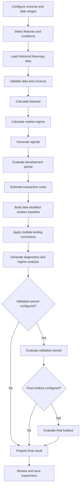
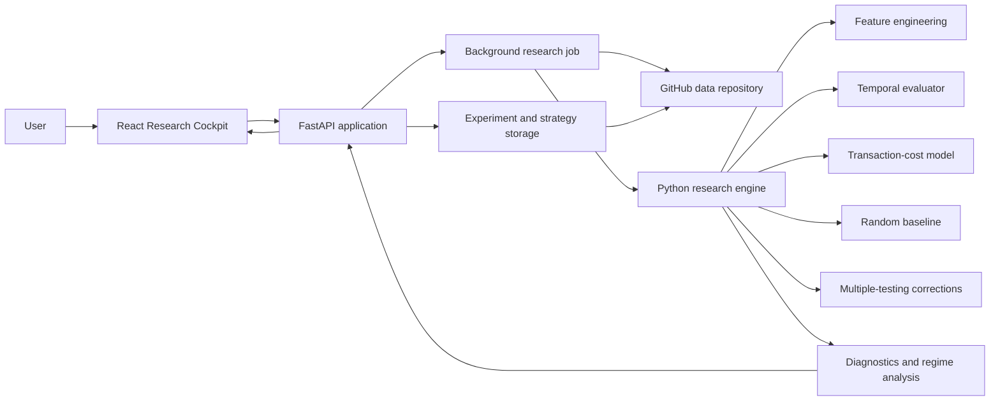

# Stock Scanner — NSE Equity Research Cockpit

**A configurable research platform for testing rule-based hypotheses on historical NSE equity data — with temporal evaluation, estimated transaction costs and statistical baselines.**

Stock Scanner helps turn a market idea into a structured historical experiment. Users can configure features and signal conditions, evaluate subsequent returns across separate development, validation and final-holdout periods, estimate costs, compare selected signals with a date-matched random baseline, and inspect diagnostics in a React-based Research Cockpit.

> **Project status:** The research and evaluation workflow is implemented. A documented, reproducible case study with development, validation and holdout findings is still being prepared. No strategy-performance claim is made here.
>
> **Research software, not an investment product.** Results are historical estimates under explicit assumptions. They are not live-trading results, investment advice, or evidence that a strategy will remain profitable.

## Quickstart

The application uses a Python/FastAPI backend and a React/Vite frontend. It also reads historical data from a separate private repository, so a GitHub token with access to that repository is required for data-backed use.

```bash
git clone https://github.com/Mohak22/Stock_scanner.git
cd Stock_scanner

conda create -n stockscanner python=3.11 -y
conda activate stockscanner

python -m pip install --upgrade pip
pip install -r requirements.txt

cd frontend
npm install
cd ..
```

Create a local `.env` file in the project root:

```dotenv
DEMO_MODE=true
STOCK_SCANNER_DATA_TOKEN=replace_with_your_github_token
FRONTEND_ORIGINS=http://localhost:5173
```

Start the backend in one terminal:

```bash
uvicorn api.main:app --reload --host 127.0.0.1 --port 8000
```

Start the frontend in another terminal:

```bash
cd frontend
npm run dev
```

Open the local Vite URL printed in the terminal (normally `http://localhost:5173`).

**Important:** `DEMO_MODE=true` is the safe read-only default. Research execution and write-capable routes are not available in this mode. The full research workflow requires `DEMO_MODE=false` in a trusted local development environment. Review the security and configuration notes below before changing it; do not expose an unprotected Development Mode server publicly.

------------------------------------------------------------------------

## Contents

-   [Project at a glance](#project-at-a-glance)
-   [Why this project exists](#why-this-project-exists)
-   [Core capabilities](#core-capabilities)
-   [Research workflow](#research-workflow)
-   [Evaluation methodology](#evaluation-methodology)
-   [Data and universe methodology](#data-and-universe-methodology)
-   [System architecture](#system-architecture)
-   [Technology stack](#technology-stack)
-   [Repository structure](#repository-structure)
-   [Local setup](#local-setup)
-   [Environment configuration](#environment-configuration)
-   [Running the application](#running-the-application)
-   [API overview](#api-overview)
-   [Testing](#testing)
-   [Important assumptions and
    limitations](#important-assumptions-and-limitations)
-   [Security and safe operation](#security-and-safe-operation)
-   [Disclaimer](#disclaimer)

------------------------------------------------------------------------

## Project at a glance

  -----------------------------------------------------------------------
  Area                                Implementation
  ----------------------------------- -----------------------------------
  Market                              NSE-listed Indian equities

  Data                                Historical equity bhavcopy archives
                                      and NIFTY 50 benchmark data

  Research interface                  React frontend --- Research Cockpit

  API                                 FastAPI

  Research engine                     Python, pandas and NumPy

  Signal construction                 Configurable feature expressions
                                      and logical conditions

  Evaluation                          Development, validation and
                                      final-holdout periods

  Horizons                            Configurable forward horizons; the
                                      interface currently offers T+1,
                                      T+3, T+5 and T+10

  Costs                               Explicit NSE equity-delivery cost
                                      estimates and configurable
                                      assumptions

  Baseline                            Date-stratified random-selection
                                      benchmark

  Statistical safeguards              Temporal stage boundaries, random
                                      baseline, Bonferroni and
                                      Benjamini--Hochberg corrections

  Persistence                         Separate GitHub data repository for
                                      market data and research records

  Tests                               pytest
  -----------------------------------------------------------------------

The application separates the code repository from the data repository:

-   **Application repository:** `Mohak22/Stock_scanner`
-   **Data repository:** `Mohak22/STOCK_SCANNER_DATA`

The data repository is private and is accessed by the backend through
the GitHub API.

------------------------------------------------------------------------

## Why this project exists

A stock scanner can identify securities that satisfy a collection of
technical or market conditions. That alone does not establish whether
those conditions contain useful information.

A rule can look attractive because it was selected after examining
historical data, because the evaluation accidentally uses information
from the future, because transaction costs are ignored, or because the
result is compared against an inappropriate baseline.

The Research Cockpit is intended to make that investigation more
structured.

It provides a configurable workflow to:

1.  Define a research universe and historical period.
2.  Select indicators and market features.
3.  Express entry conditions without hard-coding every hypothesis.
4.  Evaluate the resulting signals over subsequent trading sessions.
5.  Preserve separate development, validation and final-holdout periods.
6.  Estimate gross and net outcomes after assumed transaction costs.
7.  Compare the selected signals with random eligible selections on
    matching dates.
8.  Review diagnostics and market-regime breakdowns.
9.  Save experiments and promote research into a versioned strategy
    record.

The objective is **hypothesis evaluation and research discipline**, not
to present a collection of profitable strategies as established facts.

------------------------------------------------------------------------

## Core capabilities

### 1. Configurable research conditions

The frontend provides a research-condition builder backed by a feature
registry.

Conditions can compare a feature with a numeric value or another
feature. Supported comparison operators include:

-   `<`
-   `<=`
-   `>`
-   `>=`
-   `==`
-   `!=`

Expressions support a non-negative multiplier. Feature parameters are
validated against the feature registry rather than being accepted
without checks.

Examples of research questions that can be expressed include:

-   Does a low RSI reading identify stocks with different subsequent
    returns?
-   Does volume above its rolling average change the outcome
    distribution?
-   Does delivery percentage, or its rolling average, add useful
    information?
-   Does a price-action condition behave differently across market
    regimes?

These are examples of hypotheses to investigate, not claims that the
conditions are profitable.

### 2. Feature engineering

The feature engine supports price, volume, delivery, return,
technical-indicator and candle/price-action features.

The current feature registry includes:

  -----------------------------------------------------------------------
  Category                            Features
  ----------------------------------- -----------------------------------
  Price                               Open, High, Low, Close

  Volume                              Traded volume, average volume

  Delivery                            Delivery percentage, average
                                      delivery percentage

  Technical indicators                RSI, EMA, SMA

  Returns                             Percentage return over a
                                      configurable lookback

  Candle / price action               Upper wick, lower wick, candle
                                      range, body, wick percentages, body
                                      percentage and close position
  -----------------------------------------------------------------------

Rolling features are calculated by symbol. Their warm-up observations
remain unavailable until the required lookback has been observed;
missing warm-up values should not be treated as valid signals.

### 3. Multiple research periods

A research request can define up to three chronologically ordered
periods:

-   **Development:** explore a hypothesis and make research decisions.
-   **Validation:** examine whether the selected hypothesis behaves
    similarly on a separate period.
-   **Final holdout:** reserve a later period for a final, less
    frequently consulted evaluation.

The API validates that the periods are supplied in complete start/end
pairs and do not overlap. A later stage must start after the previous
stage ends.

The application does not make a strategy statistically valid merely by
dividing dates into three periods. The researcher must still avoid
repeatedly tuning a hypothesis against validation or holdout results.

### 4. Temporal outcome evaluation

The temporal evaluator works with each symbol's available observations.
Weekends, exchange holidays and missing symbol observations do not count
as additional symbol trading sessions.

The current convention is:

  -----------------------------------------------------------------------
  Term                                Definition
  ----------------------------------- -----------------------------------
  Signal                              Generated from feature information
                                      associated with the signal date

  Entry proxy                         Signal-date closing price

  T+1                                 Next available observation for that
                                      symbol, using its closing price

  T+N                                 Close of the N-th subsequent
                                      available observation for that
                                      symbol

  Stage eligibility                   Both the signal date and the
                                      outcome date must fall inside the
                                      evaluated stage
  -----------------------------------------------------------------------

Returns are calculated close-to-close:

`(outcome_close / signal_date_close - 1) × 100`

Each horizon is assessed independently. A signal can have an eligible
T+1 outcome while its T+5 outcome is unavailable or falls outside the
stage.

The evaluator also aligns the NIFTY 50 benchmark to the stock's actual
signal and outcome dates, allowing market return and excess return to be
calculated over the same date window.

### 5. Transaction-cost estimates

The cost model preserves gross returns and adds estimated net returns.

The default model explicitly represents:

-   Brokerage assumption
-   Securities Transaction Tax (STT)
-   Exchange transaction charges
-   SEBI charges
-   Stamp duty
-   GST on the modelled service-charge base
-   Assumed adverse slippage on both sides

The current default slippage assumption is **5 basis points per side**.
It is a modelling assumption, not a value estimated from historical
bid--ask spreads or actual fills.

The cost calculation uses effective buy- and sell-side rates and adjusts
the entry and exit prices accordingly. Net summaries include only
observations marked eligible for the relevant horizon.

The output also documents excluded or broker-dependent charges,
including per-scrip DP/depository charges, IPFT and minimum/rounded
rupee charges, and broker-specific deviations.

### 6. Date-stratified random baseline

A strategy's performance should not be interpreted in isolation. The
research engine compares selected signals with randomly selected
eligible candidates.

The implemented baseline:

1.  Uses dates on which the selected strategy actually generated
    signals.
2.  Preserves the number of eligible strategy outcomes on each date.
3.  Samples candidate outcomes without replacement within each date.
4.  Repeats the sampling procedure (999 permutations by default).
5.  Compares the observed mean net excess return with the simulated null
    distribution.
6.  Reports the null-distribution quantiles and a one-sided nominal
    p-value.

The random generator uses a deterministic seed, with a horizon-specific
offset, to support repeatable runs.

This is a date-matched selection baseline. It is **not** a complete
model of portfolio construction, capital constraints, execution, serial
dependence or overlapping positions.

### 7. Multiple-testing corrections

The research engine calculates:

-   Bonferroni-adjusted p-values
-   Benjamini--Hochberg adjusted p-values

The current correction family covers valid horizon p-values **within one
research run and one evaluation stage**.

It does not correct for every strategy variant, parameter combination,
separate research run or hypothesis explored over time. It also does not
repair invalid p-values or remove dependence caused by overlapping
forward-return windows.

Statistical significance is not equivalent to economic significance or
future profitability.

### 8. Diagnostics and market-regime analysis

The research output includes summary and performance information,
diagnostics, warnings, random-baseline results, cost analysis,
signal-level outcomes and market-regime analysis.

Market-regime analysis uses NIFTY 50 market data and a trailing-return
regime calculation. It is intended to help inspect whether a signal's
observed behaviour differs across market conditions; it should not be
interpreted as proof that a regime-specific rule will generalise.

### 9. Experiment and strategy records

The frontend includes:

-   Research configuration
-   Experiment history
-   Experiment detail
-   Strategy library
-   Strategy detail

The experiment API stores research records and strategy records in the
separate `STOCK_SCANNER_DATA` repository. Saving and other write-capable
integrations are not exposed in Demo Mode.

### 10. Background research execution and progress

Research requests are submitted as background jobs. The API returns a
job identifier, tracks status and progress, and streams progress updates
to the frontend using Server-Sent Events (SSE).

Progress is monotonic: it does not move backwards, and the progress
tracker does not mark a stage complete until the underlying operation
has actually returned.

------------------------------------------------------------------------

## Research workflow

A typical research run follows this sequence:



The engine calculates features and signals over the configured
historical data, then evaluates outcomes separately inside each
requested stage. This allows lookback information before a stage to be
available for feature calculation while enforcing strict stage
boundaries on signal and outcome eligibility.

------------------------------------------------------------------------

## Evaluation methodology

This section is intentionally explicit because the validity of a
historical research result depends on the assumptions behind it.

### Temporal convention and execution caveat

The current evaluator uses the signal-date close as an **entry-price
proxy**. If a signal is calculated using the completed day's closing
price, a trader cannot generally assume that the same closing price was
available for an order submitted after observing that close.

Consequently:

-   The current result is a close-to-close historical research
    convention.
-   It is not a simulation of an executable market-on-close order.
-   It does not model next-session opening execution.
-   It does not model order-book liquidity, partial fills or market
    impact.

This convention is useful for consistent exploratory comparisons, but a
live-execution or deployable strategy assessment would require an
execution model aligned with when the signal becomes observable and when
an order could realistically be filled.

### Stage boundaries

A signal is eligible for a stage only when its signal date is within
that stage. Its outcome is eligible only when the corresponding future
outcome date is also within the same stage.

A signal near the end of a period is therefore not allowed to use an
outcome from the next period. The evaluator records an outcome status
rather than silently including a cross-boundary return.

### Benchmark alignment

The benchmark return is measured over the same
signal-date-to-outcome-date interval used for the stock. Where the
matching benchmark observation is unavailable, the benchmark status
records that limitation and excess return is not fabricated.

### Random baseline interpretation

The random baseline asks whether the selected signals outperform random
eligible candidates sampled on the same dates while preserving the
selected strategy's eligible signal count.

Its p-value is nominal. In particular, the current procedure does not
fully account for:

-   Serial dependence in daily returns
-   Overlapping forward-return windows
-   Dependence between securities
-   Repeated experimentation across runs and strategy variants

A small nominal p-value should therefore be treated as one diagnostic,
not as a definitive proof of an edge.

------------------------------------------------------------------------

## Data and universe methodology

### Historical market data

The backend reads archived historical NSE equity bhavcopy files from the
private `STOCK_SCANNER_DATA` repository. The data access layer:

-   Uses the GitHub Contents API.
-   Reads the configured `main` branch.
-   Locates archived date-specific bhavcopy files.
-   Downloads selected files concurrently, with a bounded worker count.
-   Retries selected transient HTTP and connection failures.
-   Restores chronological order before combining the files.
-   Normalises symbol and timestamp fields.

The research engine also loads NIFTY 50 benchmark data for market-return
and market-regime calculations.

The data repository is separate from this application repository. A user
setting up the project must have access to both repositories and must
configure an appropriate GitHub token.

### Universe selection and survivorship considerations

The universe configuration supports several universe types, including
all stocks, sector/industry groupings, major stocks and explicit
symbols.

Two membership concepts are important:

**Current snapshot**

A current universe file is used to select symbols. Applying today's
universe to historical dates can introduce survivorship bias because
companies that are no longer in the current universe may be absent.

**Point-in-time all-stocks proxy**

For the all-stocks option, point-in-time membership can be derived from
historical EQ-series symbol/date records in archived bhavcopy data. The
current universe file is not used to filter those historical rows.

This is a historical-tradability proxy, not an official
listing/delisting master. Its reliability depends on the completeness
and historical coverage of the archived bhavcopy data.

Point-in-time historical sector classifications and historical index
constituents are not currently available through this mechanism. Other
universe selections use current-snapshot membership unless the
application explicitly supports a historical source for that selection.

The data-validation logic also checks expected benchmark trading-session
coverage against observed bhavcopy sessions. This can detect missing
whole sessions, but it cannot independently prove that every individual
security record is present.

------------------------------------------------------------------------

## System architecture



### Backend

The FastAPI application provides:

-   System and health endpoints
-   Historical data endpoints
-   Research feature and universe metadata
-   Dataset information
-   Background research jobs
-   Job-status retrieval
-   SSE progress streaming

The research executor orchestrates data loading, universe filtering,
feature calculation, signal generation, temporal evaluation, cost
estimation, baseline comparison and diagnostics.

### Frontend

The React application is organised around a Research Cockpit with
separate views for configuring research, reviewing saved experiments and
browsing strategy records.

The research form retrieves the feature registry from the API and
constructs a validated research request. It submits the job, listens to
progress events and retrieves the completed result.

### Data and persistence

The application code and market/research data are kept in separate
GitHub repositories. The backend uses the GitHub API for historical data
access and for write-capable experiment/strategy persistence when the
application is running outside Demo Mode.

------------------------------------------------------------------------

## Technology stack

### Backend and research

-   Python 3.11
-   FastAPI
-   Pydantic
-   pandas
-   NumPy
-   SciPy
-   scikit-learn
-   yfinance
-   pytest

### Frontend

-   React
-   Vite
-   JavaScript

### Data, integrations and automation

-   GitHub REST API
-   GitHub Actions (for repository automation where configured)
-   Playwright (for browser automation workflows)
-   PostgreSQL / pgvector dependencies
-   LangChain and OpenAI client dependencies for optional AI-related
    modules

Not every dependency is required for every execution path. Some
integrations are optional and may require additional credentials, system
packages or configuration.

------------------------------------------------------------------------

## Repository structure

The main application repository is organised approximately as follows:

``` text
Stock_scanner/
├── api/
│   ├── data/
│   │   └── github_data.py
│   ├── research/
│   │   ├── executor.py
│   │   ├── experiment_api.py
│   │   ├── features.py
│   │   ├── job.py
│   │   ├── models.py
│   │   └── universe.py
│   ├── main.py
│   └── ...
├── research/
│   └── engine/
│       ├── condition_engine.py
│       ├── cost_model.py
│       ├── feature_engine.py
│       ├── multiple_testing.py
│       ├── random_baseline.py
│       ├── regime_engine.py
│       ├── research_engine.py
│       └── temporal_evaluation.py
├── indicators/
│   ├── ema_engine.py
│   └── rsi_engine.py
├── frontend/
│   ├── src/
│   │   ├── components/
│   │   ├── api/
│   │   ├── App.jsx
│   │   └── main.jsx
│   ├── package.json
│   └── vite.config.js
├── tests/
│   └── test_temporal_evaluation.py
├── requirements.txt
└── .gitignore
```

This is a map of the main components, not an exhaustive listing of every
file.

------------------------------------------------------------------------

## Local setup

### Prerequisites

-   Python 3.11
-   Node.js and npm
-   Git
-   Access to the private `Mohak22/STOCK_SCANNER_DATA` repository
-   A GitHub token with the required repository permissions

Some optional modules may also require system tools or separate service
credentials.

### 1. Clone the application repository

``` bash
git clone https://github.com/Mohak22/Stock_scanner.git
cd Stock_scanner
```

### 2. Create and activate a Python environment

Using Conda:

``` bash
conda create -n stockscanner python=3.11 -y
conda activate stockscanner
```

Or using `venv`:

``` bash
python -m venv .venv
```

Activate the environment:

**Windows PowerShell**

``` powershell
.venv\Scripts\Activate.ps1
```

**macOS / Linux**

``` bash
source .venv/bin/activate
```

### 3. Install Python dependencies

``` bash
python -m pip install --upgrade pip
pip install -r requirements.txt
```

### 4. Install frontend dependencies

``` bash
cd frontend
npm install
cd ..
```

### 5. Configure environment variables

Create a local `.env` file in the project root. Do not commit it.

``` dotenv
# Safe default: read-only demo behaviour
DEMO_MODE=true

# GitHub access to the private STOCK_SCANNER_DATA repository
STOCK_SCANNER_DATA_TOKEN=replace_with_your_github_token

# Allowed frontend origin(s), comma-separated
FRONTEND_ORIGINS=http://localhost:5173
```

The token must have access to the private data repository. Read access
is needed for historical data retrieval. Write-capable experiment and
strategy operations require the relevant contents-write permission as
well.

Never paste a real token into source code, screenshots, logs, public
issues or a committed `.env` file.

------------------------------------------------------------------------

## Running the application

### Start the backend

From the project root:

``` bash
uvicorn api.main:app --reload --host 127.0.0.1 --port 8000
```

Backend root:

``` text
http://127.0.0.1:8000/
```

Health check:

``` text
http://127.0.0.1:8000/health
```

FastAPI interactive API documentation:

``` text
http://127.0.0.1:8000/docs
```

### Start the frontend

In a second terminal:

``` bash
cd frontend
npm run dev
```

Open the Vite URL printed in the terminal, normally:

``` text
http://localhost:5173
```

### Demo Mode and Development Mode

The backend defaults to `DEMO_MODE=true`.

**Demo Mode**

-   Read-only API behaviour.
-   Non-GET/HEAD/OPTIONS requests are rejected.
-   Research execution, persistent writes, LLM-backed routes and broker
    execution routers are not registered.
-   Intended for safe demonstration of the read-only application
    surface.

**Development Mode**

To enable research execution and the write-capable integration routers,
explicitly set:

``` dotenv
DEMO_MODE=false
```

Restart the backend after changing the environment.

Development Mode exposes additional routes and integrations. Use it only
in a trusted local environment after reviewing the relevant credentials
and execution safeguards. Do not expose an unprotected development
server to the public internet.

------------------------------------------------------------------------

## Environment configuration

  ------------------------------------------------------------------------------
  Variable                     Purpose                 Required
  ---------------------------- ----------------------- -------------------------
  `DEMO_MODE`                  Controls read-only Demo No
                               Mode versus Development 
                               Mode; defaults to       
                               `true`                  

  `STOCK_SCANNER_DATA_TOKEN`   GitHub access to the    Required for private
                               private data repository repository access
                               and write-capable       
                               research storage        

  `FRONTEND_ORIGINS`           Comma-separated allowed No; defaults to
                               frontend origins for    `http://localhost:5173`
                               CORS                    
  ------------------------------------------------------------------------------

Optional AI, broker or other integration modules may require additional
environment variables. Configure those only after checking the relevant
module's implementation. Do not assume that installing a dependency
alone activates an integration.

------------------------------------------------------------------------

## API overview

The following routes are visible in the FastAPI application. Additional
write-capable routes are registered only outside Demo Mode.

  ----------------------------------------------------------------------------------
  Method                  Endpoint                           Purpose
  ----------------------- ---------------------------------- -----------------------
  `GET`                   `/`                                Application name,
                                                             version and current
                                                             mode

  `GET`                   `/health`                          Backend and
                                                             data-repository health

  `GET`                   `/data/dates`                      Available historical
                                                             data dates

  `GET`                   `/data/bhavcopy`                   Retrieve bhavcopy rows
                                                             for a date range

  `GET`                   `/research/features`               Retrieve the research
                                                             feature registry

  `GET`                   `/research/universe`               Retrieve
                                                             research-universe
                                                             metadata

  `GET`                   `/research/dataset-info`           Dataset information for
                                                             a requested date range

  `GET`                   `/research/jobs/{job_id}`          Retrieve research job
                                                             status and result

  `GET`                   `/research/jobs/{job_id}/stream`   Stream job progress
                                                             using SSE
  ----------------------------------------------------------------------------------

In Development Mode, the research execution endpoint is registered:

  Method   Endpoint          Purpose
  -------- ----------------- ----------------------------------
  `POST`   `/research/run`   Submit a background research run

Experiment, strategy, research-agent and execution routes are
conditionally registered in Development Mode. Their exact request
schemas should be inspected through `/docs` for the running version.

------------------------------------------------------------------------

## Testing

The project uses pytest.

Run the complete test suite from the repository root:

``` bash
pytest -q
```

Run the temporal-evaluation tests specifically:

``` bash
pytest tests/test_temporal_evaluation.py -q
```

The temporal test module covers important behaviours such as:

-   Signal-date entry proxy and subsequent-session horizons
-   Strict stage-boundary eligibility
-   Independent horizon eligibility
-   Missing symbol sessions
-   Entry/outcome chronological ordering
-   Future-data invariance for prior feature values and signals
-   Feature warm-up behaviour
-   Benchmark alignment to the stock's actual outcome date
-   Evaluation on later date ranges without a hard-coded historical
    cutoff

A passing test suite verifies the behaviours covered by those tests; it
does not prove that every data source is complete or that a strategy is
profitable.

------------------------------------------------------------------------

## Important assumptions and limitations

A research tool should make its limitations visible. The following are
material limitations of the current implementation.

### 1. Close-price entry is a proxy

Signals are evaluated using the signal-date close as the entry-price
proxy. If the signal requires the completed closing price, the same
closing price may not be executable after the signal is known. Results
should not be described as live-executable returns.

### 2. Slippage is assumed

The default slippage is an explicit basis-point assumption per side. It
is not estimated from historical bid--ask spreads, order-book depth,
market impact or actual broker fills. Results can change materially
under different assumptions.

### 3. Transaction-cost schedule is an estimate

The model includes the listed statutory and assumed charges but excludes
certain charges and broker-specific rounding/minimums. Users should
update the cost assumptions for the relevant broker, product and
applicable fee schedule before relying on net-return estimates.

### 4. Random-baseline p-values are nominal

The date-stratified baseline preserves signal counts per date, but does
not fully correct for serial dependence, overlapping outcomes,
cross-security dependence or repeated experimentation.

### 5. Multiple-testing scope is limited

Bonferroni and Benjamini--Hochberg corrections are applied across valid
horizons within one run and one stage. They do not account for all
strategies, parameters and experiments tried over time.

### 6. Universe history is imperfect

The point-in-time all-stocks universe is derived from archived EQ-series
bhavcopy observations. It is a historical-tradability proxy, not an
official listing/delisting master. Missing historical files or symbol
records can affect results.

Current-snapshot universes can introduce survivorship bias when used for
historical research. Historical sector and index membership are not yet
available through the point-in-time mechanism.

### 7. Data completeness remains important

Session-coverage validation can detect missing whole trading sessions
relative to the benchmark. It cannot independently establish that every
symbol's record is present and correct on every date.

### 8. Historical relationships may not persist

Market structure, liquidity, fees, regulations and participant behaviour
change. A historical pattern may disappear or reverse. Validation and
holdout periods reduce some forms of overfitting risk but cannot
eliminate them.

### 9. Portfolio-level constraints are not fully modelled

Signal-level returns and date-stratified random selections do not by
themselves constitute a complete portfolio backtest. Capital allocation,
concurrent positions, cash availability, position sizing, liquidity
limits, order execution, partial fills and portfolio drawdown need
separate modelling before a strategy can be treated as deployable.

### 10. Background job storage is in memory

The current research job store is process-local and in-memory. Job state
is not a durable distributed queue and can be lost when the API process
restarts. It is suitable for the current application workflow, not a
claim of production-grade job orchestration.

------------------------------------------------------------------------

## Security and safe operation

-   Keep `.env` files and tokens out of version control.
-   The repository `.gitignore` excludes `.env` and common local
    build/cache outputs.
-   Demo Mode is enabled by default and rejects write requests.
-   Write-capable, LLM and broker-related routers are conditionally
    registered outside Demo Mode.
-   Keep Development Mode on localhost unless authentication, network
    controls and deployment security have been added.
-   Use a token with the minimum permissions needed for the task.
-   Do not enable broker execution with real funds as part of a
    demonstration.
-   Review all integration-specific safeguards and configuration before
    enabling external actions.

------------------------------------------------------------------------

## Disclaimer

Stock Scanner is an independent software and research project. It is
intended for educational, analytical and experimental use.

Historical backtests and statistical tests are sensitive to data
quality, assumptions, selection effects and repeated experimentation.
Neither positive historical returns nor statistical significance
guarantees future performance. The application does not provide
investment advice, recommendations, or assurances of profit.

Users are responsible for independently validating data, assumptions,
costs, execution feasibility, regulatory requirements and risks before
making any financial decision.
